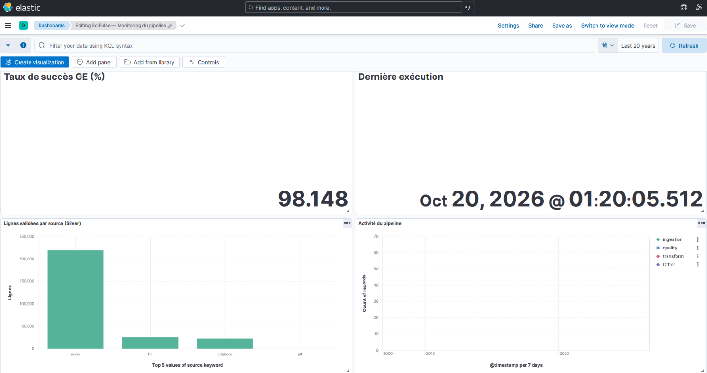

# SciPulse & SciPulse Insights

> **Plateforme de veille scientifique à grande échelle** : elle croise **218 851 articles ArXiv**, **25 511 posts
> Hacker News** et **22 472 fiches de citations OpenAlex** pour identifier les articles les plus significatifs, qu'ils
> soient influents dans la communauté scientifique, populaires auprès du public tech, ou les deux.

Architecture **Medallion** (Bronze → Silver → Gold) sur **MinIO**, orchestrée par **Airflow**, validée par
**Great Expectations**, traitée par **Apache Spark** et servie par **Elasticsearch / Kibana**.

**Auteur** : Yahya Qabil — Projet #4, L'École Multimédia

---

## Sommaire

1. [Architecture](#1-architecture)
2. [Démarrage rapide](#2-démarrage-rapide)
3. [Pipeline et orchestration](#3-pipeline-et-orchestration)
4. [Choix techniques](#4-choix-techniques)
5. [Score d'impact composite](#5-score-dimpact-composite)
6. [Résultats](#6-résultats)
7. [Dashboards Kibana](#7-dashboards-kibana)
8. [Notebooks et validation](#8-notebooks-et-validation)
9. [Limites et pistes d'amélioration](#9-limites-et-pistes-damélioration)
10. [Structure du dépôt](#10-structure-du-dépôt)

---

## 1. Architecture

```
                     ┌─────────────── Airflow (orchestration) ───────────────┐
 ArXiv  (batch)  ────┤                                                        │
 HN     (5 min)  ────┼──►  BRONZE  ──GE──►  SILVER  ──Spark──►  GOLD  ──►  Kibana
 OpenAlex (bulk) ────┘     MinIO           MinIO              Elasticsearch
                           JSON Lines      Parquet            arxiv-papers-enriched
                                                │
                          métriques (Logstash) ─┴──►  pipeline-monitoring  ──►  Kibana
```

| Couche | Stockage | Contenu |
|---|---|---|
| **Bronze** | MinIO `arxiv-raw/`, `hn-raw/`, `citations-raw/` | Données brutes, JSON Lines, **aucune transformation** |
| **Silver** | MinIO `arxiv-clean/`, `hn-clean/`, `citations-clean/` | Données nettoyées et validées (Great Expectations), Parquet, une table par source |
| **Gold** | Elasticsearch `arxiv-papers-enriched` | Jointure des 3 sources, indicateurs, TF-IDF, score d'impact : **seule couche visible dans Kibana** |

| Service | Rôle | URL locale |
|---|---|---|
| Airflow | Orchestration (4 DAGs) | http://localhost:8081 (admin / admin) |
| MinIO | Data lake Medallion | http://localhost:9001 (minioadmin / minioadmin123) |
| Spark | Traitement distribué (1 master + 1 worker) | http://localhost:8080 |
| Elasticsearch | Couche Gold (serving) | http://localhost:9200 |
| Kibana | Dashboards | http://localhost:5601 |
| Logstash | Métriques du pipeline → `pipeline-monitoring` | port 8090 |
| PostgreSQL | Métastore Airflow | — |

## 2. Démarrage rapide

**Prérequis** : Docker Desktop (≥ 10 Go de RAM alloués à WSL2/Docker, **≥ 20 Go d'espace disque libre**) et un compte
Kaggle (clé API gratuite).

```bash
cp .env.example .env              # puis renseigner KAGGLE_USERNAME, KAGGLE_KEY, OPENALEX_MAILTO
docker compose up -d --build      # ou : make up
docker compose exec airflow-scheduler python /opt/airflow/scripts/init_es.py      # index + mappings (make init-es)
docker compose exec airflow-scheduler python /opt/airflow/scripts/init_kibana.py  # data views (make init-kibana)
```

Puis, dans Airflow, activer et déclencher les DAGs dans cet ordre :

| Ordre | DAG | Effet |
|---|---|---|
| 1 | `hn_backfill` (une fois) | Historique des posts HN pointant vers arxiv.org |
| 2 | `hn_microbatch` | Polling HN toutes les 5 minutes |
| 3 | `arxiv_batch` | Dump Kaggle → Bronze → Silver (GE) → index `arxiv-papers` |
| 4 | `scipulse_pipeline` | HN Silver → citations Bronze/Silver → **job Spark Gold** → `arxiv-papers-enriched` |

Enfin, importer les dashboards : *Kibana → Stack Management → Saved Objects → Import → `kibana/dashboards.ndjson`*.

<details>
<summary>Windows / PowerShell (sans <code>make</code>)</summary>

```powershell
Copy-Item .env.example .env
wsl -d docker-desktop sysctl -w vm.max_map_count=262144     # requis par Elasticsearch
docker compose up -d --build
```
</details>

| Commande | Effet |
|---|---|
| `make up` / `make down` / `make reset` | Démarrer / arrêter / tout supprimer (volumes inclus) |
| `make init-es` / `make init-kibana` | Index Elasticsearch / data views Kibana |
| `make spark-gold` | Lancer le job Spark Gold à la main |
| `make test` / `make lint` | 21 tests unitaires / lint (ruff) |

## 3. Pipeline et orchestration

| DAG | Planification | Tâches |
|---|---|---|
| `arxiv_batch` | hebdomadaire, `max_active_runs=1` | bronze → silver (GE) → gold_partial |
| `hn_microbatch` | toutes les 5 min | poll (état : Variable Airflow `hn_last_seen_id`, reprise sans doublon) |
| `hn_backfill` | manuel | backfill Algolia (posts vers arxiv.org) |
| `scipulse_pipeline` | quotidien | hn_silver → citations_bronze → citations_silver → **spark_gold** |

Chaque tâche envoie ses métriques (volumes, résultats Great Expectations, horodatage) à **Logstash**, qui les indexe dans
`pipeline-monitoring` pour le dashboard de supervision.

**Clés de jointure** : `arxiv_id` sans version (`2301.12345v2 → 2301.12345`). Pour HN, l'identifiant est extrait de
l'URL (`abs/`, `pdf/`, `html/`) ; pour OpenAlex, il est retrouvé dans `locations` (voir §4).

## 4. Choix techniques

| Choix | Justification |
|---|---|
| **OpenAlex** comme source de citations | API ouverte sans clé, requêtes par lot (50 DOI), `counts_by_year` pour la vélocité, `referenced_works` pour un graphe de citations, licence CC0. Semantic Scholar renvoie souvent des 429 sans clé. |
| Association OpenAlex ↔ ArXiv via `locations` | Le champ `doi` d'OpenAlex pointe vers la **version publiée** (ex. `10.65215/…`), pas vers le DOI arXiv : une jointure sur le DOI aurait perdu presque toutes les citations. |
| **Backfill HN via l'API Algolia** | L'API Firebase ne fournit que les items récents : sans historique, la jointure HN × ArXiv serait vide. |
| **Périmètre ArXiv** `cs.*`/`stat.ML` 2024+ **+ articles cités sur HN** | Le dump est trié chronologiquement : les 200 000 premières lignes (2007–2009) ne couvraient que **1,3 %** des posts HN. Le périmètre retenu atteint **≈ 100 %** (lignes recopiées octet pour octet en Bronze). |
| Image **MinIO Chainguard** + création des buckets en Python | Les images `minio/minio` et `minio/mc` ont été retirées de Docker Hub (sept. 2026). |
| Airflow en **Python 3.10** | Même version que les workers Spark (sinon `PYTHON_VERSION_MISMATCH`). |
| Image Spark dérivée avec **numpy** | Requis par `pyspark.ml` sur les workers. |
| Parquet en **microsecondes** | Spark 3.5 ne lit pas les timestamps en nanosecondes écrits par pandas. |
| Job Spark lancé via `python` | `spark.jars.packages` (connecteurs S3A, Elasticsearch) n'est appliqué que si la session est créée par le code. |
| **Broadcast** pour HN agrégé | Petite table : jointure sans shuffle de la table ArXiv (−28 % de temps mesuré, notebook 02). |
| Écriture ES avec `es.mapping.id = arxiv_id` | Ré-exécution **idempotente** (upsert). |
| Sécurité Elasticsearch désactivée | Environnement de développement local uniquement. |

Tous les problèmes rencontrés et leurs solutions sont consignés dans [docs/troubleshooting.md](docs/troubleshooting.md).

## 5. Score d'impact composite

$$\text{impact} = 100 \times \big(0{,}5 \cdot \text{cit\_norm} + 0{,}3 \cdot \text{hn\_norm} + 0{,}2 \cdot \text{recency}\big)$$

| Composante | Calcul | Pourquoi |
|---|---|---|
| `cit_norm` | `percent_rank` de `log1p(citations)` **par catégorie** | Comparer des domaines aux volumes de citations très différents |
| `hn_norm` | `percent_rank` de `log1p(score + commentaires)` parmi les articles présents sur HN | Signal de popularité tech, en échelle log |
| `recency` | $e^{-\ln 2 \cdot \text{âge}/2}$ (demi-vie de 2 ans) | Ne pas pénaliser les articles trop récents pour avoir été cités |

Analyse de sensibilité (notebook 02) : le classement global est **robuste** (Spearman ≥ 0,995 avec les variantes
« académique » et « tech »), mais **la récence pilote le haut du classement**. Sans elle, le top 100 change à 97 % et sa
médiane de citations passe de **3 à 274**. → Score de référence conservé pour la **veille** ; un score sans récence est
proposé pour mesurer l'**influence historique**.

Détails : [docs/impact_score.md](docs/impact_score.md).

## 6. Résultats

| Indicateur | Valeur |
|---|---|
| Articles dans la couche Gold | **218 851** |
| Posts HN (Silver) / articles distincts cités sur HN | 25 511 / 18 864 |
| Fiches de citations OpenAlex | 22 472 |
| Articles avec ≥ 1 citation / sur HN / les deux | 6,8 % / 8,6 % / 6,1 % |
| Great Expectations (ArXiv, HN, citations) | **100 %** après nettoyage |
| Pépites cachées (très citées, jamais sur HN) | 1 358 |
| Hype HN (virales, peu citées) | 380 |
| Sous-domaines en plus forte croissance | `stat.ML` (+15,4 %/mois), `cs.LG` (+10,3 %), `cs.AI` (+10,2 %) |

**Enseignements**

- Les articles discutés sur HN sont presque tous **déjà cités** : HN amplifie surtout des travaux visibles.
- Le corpus récent (2024–2025) est dominé par les **agents, le raisonnement et le RAG** (termes TF-IDF distinctifs de
  `cs.AI` et `cs.CL`).
- « 0 citation » signifie souvent « pas encore de données » (couverture OpenAlex partielle) : *DeepSeek-R1* apparaît ainsi
  dans la « Hype HN » alors qu'il est très cité.

## 7. Dashboards Kibana

Exportés dans [`kibana/dashboards.ndjson`](kibana/dashboards.ndjson).

| Dashboard | Panneaux |
|---|---|
| **SciPulse — Dashboard augmenté** | KPI (articles, score médian, mentions HN, citations) · Top 20 impact · Pépites cachées · Hype HN · Top 15 catégories · Évolution des catégories |
| **SciPulse — Monitoring du pipeline** | Taux de succès Great Expectations · Fraîcheur (dernière exécution) · Volumes par source · Activité du pipeline par étape |




## 8. Notebooks et validation

| Notebook | Contenu |
|---|---|
| [`01_quality_eda`](notebooks/01_quality_eda.ipynb) | Qualité Bronze (manquants, types, doublons, anomalies), statistiques Silver, règles Great Expectations avant/après, procédure de nettoyage, couverture des jointures |
| [`02_spark_pipeline`](notebooks/02_spark_pipeline.ipynb) | Choix d'OpenAlex, jointure à 3 sources, **broadcast vs sort-merge** (`.explain()`, temps), window functions, TF-IDF, score d'impact et **analyse de sensibilité** |
| [`03_validation`](notebooks/03_validation.ipynb) | **Jeux de test indépendants** (articles de maths et de physique 2023, posts HN récents), cohérence Gold, **6 requêtes analytiques** vérifiées, tableau de validation, captures Kibana |

Exécution (dans le conteneur, qui contient Spark et accède aux services) :

```bash
docker compose exec airflow-scheduler python -m nbconvert --to notebook --execute --inplace \
    /opt/airflow/notebooks/02_spark_pipeline.ipynb --ExecutePreprocessor.timeout=1800
```

Tests unitaires : 21 tests (`tests/`) sur la normalisation des identifiants, le nettoyage, l'échantillonnage Bronze et
l'association des citations (`make test`).

## 9. Limites et pistes d'amélioration

| Limite | Piste |
|---|---|
| Couverture OpenAlex ≈ 45 % des articles demandés | Champ `has_citation_data` ; compléter avec Semantic Scholar |
| Corpus plafonné à 200 000 articles (coupure début 2025) | Augmenter `ARXIV_MAX_RECORDS` avec plus de ressources |
| Percentile sur une distribution concentrée en 0 | Lissage bayésien ; percentile calculé sur les seuls articles cités |
| Récence dominante dans le score | Deux scores : « veille » et « influence » |
| Extensions optionnelles non réalisées | Structured Streaming sur `hn-raw/`, PageRank (GraphFrames) via `referenced_works`, KMeans/PCA sur les vecteurs TF-IDF |

## 10. Structure du dépôt

```
├── dags/                    # DAGs Airflow (fins : appellent src/scipulse/tasks.py)
├── src/scipulse/
│   ├── ingestion/           # Bronze : arxiv, hn, citations
│   ├── quality/             # suites Great Expectations + runner (checkpoint, Data Docs)
│   ├── cleaning/            # Silver : nettoyage, normalisation des clés de jointure
│   ├── spark/               # Gold : jointure, indicateurs, TF-IDF, score, écriture ES
│   ├── common/              # MinIO, Parquet, Spark, ES, monitoring
│   └── tasks.py             # points d'entrée des tâches Airflow
├── docker/                  # images Airflow (Java + deps) et Spark (numpy)
├── elasticsearch/mappings/  # mappings des index Gold
├── logstash/pipeline/       # ingestion des métriques du pipeline
├── great_expectations/      # contexte GX, suites, checkpoints, Data Docs
├── kibana/                  # export des dashboards
├── notebooks/               # 01 qualité · 02 Spark · 03 validation
├── docs/                    # architecture, score, décisions, troubleshooting, captures
├── scripts/                 # init buckets, index ES, data views Kibana
└── tests/                   # tests unitaires (pytest)
```

---

*Projet réalisé par Yahya Qabil, avec l'assistance de Claude (Anthropic) pour une partie du code et de la documentation.*
